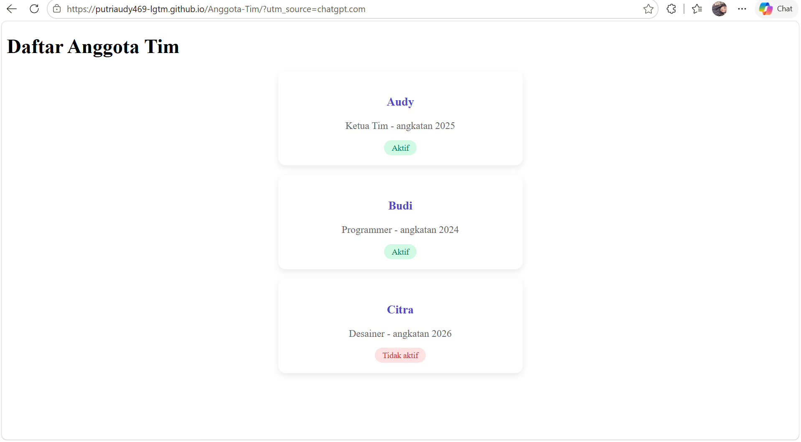

# Aplikasi Anggota Tim

## 1. Judul, Deskripsi, dan Screenshot Aplikasi

Aplikasi Anggota Tim merupakan aplikasi berbasis web yang dikembangkan menggunakan React dan Vite. Aplikasi ini bertujuan untuk menampilkan informasi anggota tim melalui antarmuka yang sederhana, menarik, dan mudah digunakan.

**Link aplikasi:** https://putriaudy469-lgtm.github.io/Anggota-Tim/

### Screenshot Aplikasi

Tambahkan screenshot asli aplikasi yang sudah dijalankan di browser pada bagian ini.

Jika gambar disimpan dengan nama `aplikasi.png` di folder `screenshots`, gunakan kode berikut:



## 2. Daftar Komponen dan Props

Komponen digunakan untuk membagi tampilan aplikasi menjadi beberapa bagian agar kode lebih terstruktur dan mudah dikelola.

| Komponen | Props | Fungsi |
|---|---|---|
| `App` | Sesuai kode komponen | Komponen utama yang mengatur tampilan aplikasi. |
| Komponen Navbar | Sesuai kode komponen | Menampilkan navigasi untuk berpindah halaman atau bagian aplikasi. |
| Komponen Anggota | Sesuai kode komponen | Menampilkan informasi anggota tim. |

**Catatan:** Nama komponen dan props di atas merupakan contoh. Sesuaikan dengan komponen yang benar-benar terdapat dalam source code proyek.

## 3. Cara Menjalankan Proyek

### Persyaratan
- Node.js
- Git
- Koneksi internet untuk mengunduh repositori dan dependensi

### Langkah Instalasi

**1. Clone repositori**

```bash
git clone https://github.com/putriaudy469-lgtm/Anggota-Tim.git
```

**2. Masuk ke folder proyek**

```bash
cd Anggota-Tim
```

**3. Instal dependensi**

```bash
npm install
```

**4. Jalankan aplikasi**

```bash
npm run dev
```

**5. Buka aplikasi**

Buka alamat lokal yang muncul di terminal, biasanya:

`http://localhost:5173`

Aplikasi sekarang dapat diakses melalui browser lokal.

## 4. Penggunaan AI

Dalam proses pengembangan proyek, AI digunakan sebagai alat bantu untuk memahami permasalahan pemrograman, membantu memperbaiki kesalahan kode, memberikan arahan konfigurasi GitHub Pages, dan menyusun dokumentasi proyek.

Hasil yang diberikan AI diperiksa dan disesuaikan dengan kebutuhan proyek. Pengembang tetap bertanggung jawab untuk memahami, menguji, dan memastikan aplikasi berjalan dengan baik.
